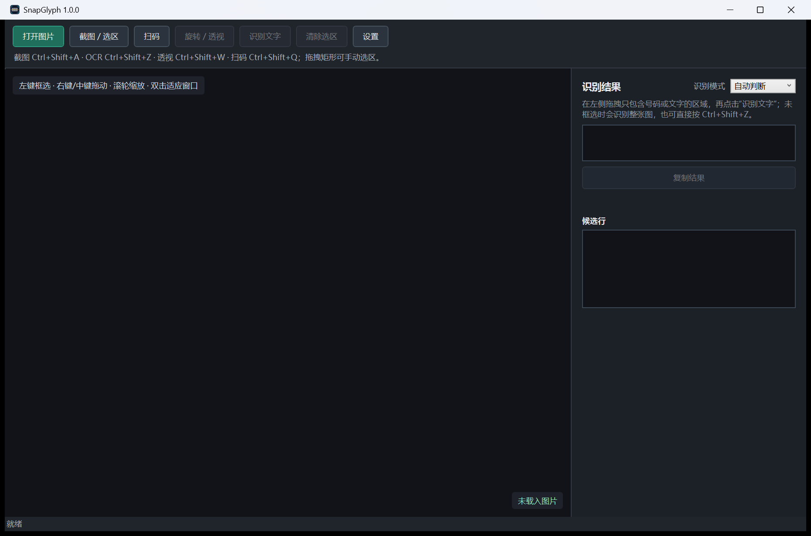

<p align="center">
  
</p>

<h1 align="center">SnapGlyph</h1>

<p align="center">把屏幕和照片里的像素，变成可直接使用的文字与数据。</p>

<p align="center">
  <a href="#系统要求"></a>
  <a href="#离线与隐私"></a>
  <a href="LICENSE"></a>
</p>

SnapGlyph 是一款面向 Windows 的离线截图、OCR 和条码扫描工具。它专为“需要频繁从屏幕或手拍照片中取数”的场景设计：截图后直接进剪贴板，OCR 可以只识别选区，遇到旋转或透视照片时可以手动校正，二维码和一维条码也能从全屏选区中直接读取。

项目不使用云服务，不上传图片，不需要登录，也不会在后台发起联网识别请求。

<p align="center">
  
</p>

## 功能

- **前台控件截图**：识别前台窗口的子控件，滚轮切换控件层级，默认选择鼠标所在位置的最小控件。
- **自由鼠标选区**：截图、OCR、扫码都支持全屏选区、十字辅助线、右键退出和防点击穿透。
- **离线 OCR**：PP-OCRv6 Small / Medium，支持中文、英文和数字；默认 800 ms 超时，可在设置中调整。
- **单行号码模式**：自动判断明显数字行；不按固定位数过滤，也不会拼接相邻行或重复行。
- **旋转与透视编辑**：自由旋转、实时四角透视、拖动、缩放和 OCR 选区；调整后可直接重新框选识别。
- **本地 AI 自动校正**：聊胜于无的功能，有点用但不要对它抱太大期望。
- **条码 / 二维码**：支持 QR、Micro QR、Data Matrix、Aztec、PDF417，以及 Code 128、Code 39/93、ITF、Codabar、EAN/UPC、DataBar、Telepen 等一维码。
- **后台工作流**：可只驻留托盘，支持开机自启动、自定义快捷键、通知时长和选区/十字线颜色。

## 系统要求

- Windows 10 或 Windows 11，x64。
- 纯 CPU 推理，推荐 4 核以上 CPU。
- 正式 Release 为自包含便携版，不需要另装 .NET Runtime。

## 下载与运行

1. 打开 [GitHub Releases](https://github.com/Emilia-EMT/SnapGlyph/releases)，下载 `SnapGlyph-portable-win-x64-v*.zip`。
2. 解压到任意本地目录。
3. 运行 `SnapGlyph.exe`。

程序默认留在系统托盘。关闭主窗口不会退出；要完全退出，请使用托盘菜单中的“退出”。

## 默认快捷键

| 功能 | 快捷键 |
| --- | --- |
| 截图 / 控件选区 | `Ctrl+Shift+A` |
| 鼠标选区 OCR | `Ctrl+Shift+Z` |
| 旋转 / 透视编辑 | `Ctrl+Shift+W` |
| 条码 / 二维码扫描 | `Ctrl+Shift+Q` |

所有快捷键都可以在“设置 → 快捷键”中重新录制。

## 推荐工作流

### 只识别照片中的一小块文字

1. 按 `Ctrl+Shift+Z` 进入 OCR 选区。
2. 只框住目标文字行，并保留少量左右和上下留白。
3. 识别结果会直接复制到剪贴板；是否同时显示主窗口由设置决定。

### 照片角度或透视不正确

1. 先截图或打开原图。
2. 按 `Ctrl+Shift+W` 打开旋转 / 透视编辑器。
3. 手动拖动四角，或尝试“AI 自动校正”。
4. 调整完成后，在该窗口按 `Ctrl+Shift+Z`，直接在修正后的图片上框选 OCR。
5. 点击“完成”会应用调整并回到主窗口。

### 扫描一维码或二维码

按 `Ctrl+Shift+Q`，让选区包含完整的条码符号和四周白边。一维码应尽量保持左右白边；二维码或复杂条码可以包含少量背景。SnapGlyph 会依次尝试原图、透视定位、缩放和角度搜索。

## 识别规则

OCR 结果遵循以下约束，这些约束用于避免常见的重复输出与错误拼接问题：

1. 先按检测框几何重叠做去重。
2. 每个重叠簇只保留一条候选。
3. 每次只输出一个文字行。
4. 不拼接相邻行或重复行。
5. 不按任何固定长度过滤。
6. 被抑制的重复框只用于诊断，不进入剪贴板。

## 性能与超时

- 默认识别模型为 PP-OCRv6 Small，优先保证交互延迟；需要更高精度时可在设置中切换为 Medium。
- OCR 默认超时为 800 ms，可在 `100–30000 ms` 范围内配置；超时结果不会写入剪贴板。
- 扫码使用约 500 ms 的内部预算，并按低清缩放、透视定位和多角度的顺序提前返回。
- ONNX Runtime 的线程数交给运行时按 CPU 自动调度。

## 离线与隐私

- 不联网、不上传图片、不发送遥测。
- OCR、文档校正和条码解码全部在本机 CPU 上运行。
- 设置保存在 `%LOCALAPPDATA%\SnapGlyph\hotkeys.json`。

## 从源码构建

需要 Windows 和 .NET 10 SDK，具体版本见根目录 [`global.json`](global.json)。

```powershell
pwsh .\scripts\fetch-models.ps1
dotnet restore .\src\SnapGlyph.slnx
dotnet build .\src\SnapGlyph.slnx -c Release
dotnet run --project .\src\SnapGlyph.App\SnapGlyph.App.csproj
```

模型文件约 183 MB，不提交到 Git。`fetch-models.ps1` 会按 [`models/MANIFEST.sha256`](models/MANIFEST.sha256) 下载并校验所有运行所需文件。

命令行示例：

```powershell
dotnet run --project .\src\SnapGlyph.Cli -- .\sample.jpg --model standard
dotnet run --project .\src\SnapGlyph.Cli -- .\sample.jpg --crop 30,1090,900,100
dotnet run --project .\src\SnapGlyph.Cli -- .\barcode.jpg --scan
```

## 发布便携包

```powershell
pwsh .\scripts\build-release.ps1
```

输出位于 `outputs/`，包含自包含程序目录、ZIP 和 SHA-256 校验文件。

## 项目结构

```text
src/
  SnapGlyph.App/        WPF 桌面应用
  SnapGlyph.Core/       OCR、条码扫描和结果筛选
  SnapGlyph.Cli/        命令行验证工具
  CaptureSmoke/         截图 smoke test
  TransformSmoke/       图像变换 smoke test
models/                 模型清单（二进制文件从 Release 或脚本获取）
scripts/                模型下载与发布脚本
docs/                   文档与品牌资源
```

## 第三方组件与模型

项目代码采用 MIT License。OCR、条码和图像处理依赖及模型分别遵循其原始许可证，完整清单与来源见 [`THIRD_PARTY_NOTICES.md`](THIRD_PARTY_NOTICES.md)。

主要组件包括：

- RapidOcrNet、PP-OCRv6 与 PaddleOCR
- ZXingCpp
- OpenCvSharp / OpenCV
- Microsoft ONNX Runtime
- DocAligner 与 PP-LCNet 文档方向模型

## 已知限制

- 这不是针对手写体优化的通用手写 OCR；主要目标是印刷体中文、英文和数字。
- 极端模糊、反光、低对比度或被遮挡的条码可能无法解码。
- 自动方向判断是本地小模型，置信度不足时会保留原方向，需要人工调整。
- 高精度模型会明显增加内存占用和推理时间，默认推荐 Small。
- 当前发布目标为 Windows x64；其他平台未提供受支持的构建。

## 贡献与反馈

提交代码前请阅读 [`CONTRIBUTING.md`](CONTRIBUTING.md)。安全问题请按 [`SECURITY.md`](SECURITY.md) 私下报告，不要在公开 Issue 中附带包含真实号码、条码或个人信息的原图。请尽量使用脱敏样张复现问题。

## License

[MIT](LICENSE)。第三方组件和模型不因本项目采用 MIT 而改变其原始许可证。

---

<h1 align="center">⚡ Powered by Codex</h1>

<p align="center">
  Built and iterated with <a href="https://openai.com/codex/"><strong>OpenAI Codex</strong></a>.
</p>
